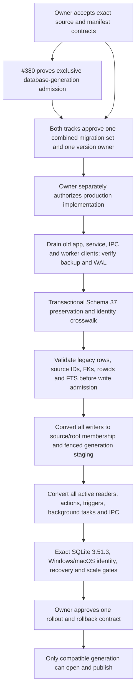

# D4 Production Integration — Dependency DAG and Data Protection Order

**Status:** design sequencing only. No production implementation or schema allocation is authorized. The graph consumes the Owner-accepted Root Membership + Effective Visibility research model and the S2 physical source-incarnation candidate; it does not amend those decisions.

## Required order

Every edge is a gate. D4-S7 completes only the source inventory and dependency definition. The current #380 product-generation gate and joint migration plan are still prerequisites, so the graph cannot advance to `D` from this report.

## Data authority conversion map

| Current producer/consumer | Required conversion before pointer authority | Preserved data / test proof |
|---|---|---|
| `Scanner::scanned_entry_to_insert_request`, `insert_files`, `upsert_file_rows_tx`, restore insert helpers | Stop using path as new `files.id`; map opaque `source_id` to retained `files.id`; record immutable path entries and root-generation membership. Keep Schema 37 IDs and rowids for legacy rows. | Copy row counts and all current fields; `PRAGMA foreign_key_check`; old/new same-path test; rename continuity and hard-link separation. |
| `files.path UNIQUE` and current path-based File Library scopes | The accepted S2 candidate removes path uniqueness only in a jointly approved migration. Queries resolve `source_id` and effective root membership through the published manifest; path is an observed entry, never identity. | Same path can hold different source incarnations; no side-row transfer; legacy unknown roots have no active membership until explicit claim or verified observation. |
| `files.is_stale` writers/readers and row triggers | Convert stale writes into generation membership loss/publication. Keep stale bit as migration evidence/derived compatibility data only; no active route may fall back to it. | All 103 production/schema groups in the frozen S1 function inventory must have an owner and test; watcher/root A loss must preserve valid root B. |
| File Library browse, counts, details, path resolution, selections, previews/actions | Resolve the same manifest snapshot for every query. Active by-ID lookup checks effective source; history lookup is a separate read-only route. Actions carry source/manifest revisions and re-open native identity. | Queries/pages, detail, selection, preview and action tests all use the same root/source set. Expired tokens fail closed. |
| Tags and user file metadata | Preserve existing FK anchor `files.id` and crosswalk to the original source. Tag counts and selection writes join effective sources; tag writes use their own revision plus manifest-bound target-set CAS. | Tags remain on the old source after root loss/path reuse. Publication never deletes or rewrites user associations. No standalone file Notes API/table exists in audited master; finding-decision `note` remains attached to its finding. |
| Operation, classification, analysis and finding history | Keep snapshots and old identifiers. Do not resolve a replacement by path. Add/use source links only under an approved explicit association; active actions revalidate current source and identity. | Old history remains visible through historical APIs after source hide. Restore/preview must reject if identity no longer matches; no old history is attached to the new source. |
| FTS and content artifacts | `files_fts`, `content_artifact_fts`, and Global Index FTS keep independent physical indexes. Each active query joins the correct effective source authority; only current content artifacts for the effective source are searchable. Manifest publication explicitly revises search/cursor authority because pointer flips do not fire `files` triggers. | External-content integrity/rebuild/reopen, content artifact hide/search, FTS rowid mapping, rename and same-path reuse tests. BM25 corpus definition is a separate hard gate. |
| Dedupe, analysis, classification, Organization, AI and automation | Candidate membership and job read sets include source ID, source revision, root/manifest revision, domain/policy revision and cancellation/run ownership. Completion CAS rejects changed/hidden sources; old evidence stays history. | Race each job with root change/path reuse and check no output attaches to a replacement. Overlap membership loss from one root cannot globally invalidate a still-visible source. |
| Global Index bridge | Leave `global_entries`, Global Index source health and its own FTS independent. Only the explicit managed-scope/AI bridge resolves a source ID and current manifest; never join or transfer solely by path. | Global-only search and AI state remain unchanged by managed publication; bridge queue/claim/completion reject stale authority. |
| Startup/recovery/GC/cursors | Durable owner rows identify generation/session/root/source and publication state. Recovery compares the pointer and resumes or abandons idempotently. Cursor/read leases retain the exact authority needed; GC must recheck references. | Crash before/after commit yields old or new manifest only; old cursor rejected or supported through a proven lease; pinned reader blocks collection. |

## Client, Service and database-generation boundary (#380)

Schema 37 registers and exposes old commands alongside File Library V2, including `get_paged_files`, `search_files`, `insert_file`, `upsert_files_by_paths`, and `remove_files_by_paths` (the registrations are in `src-tauri/src/main.rs`; wrappers are in `src-tauri/src/db/commands.rs`). Those clients know the path-shaped file identity and raw stale-bit contract. If any old renderer, app process, resident Service, worker or already-open DB connection can still write after migration, it can bypass the manifest, overwrite a path incarnation or regress search/revision state.

Therefore the #380 gate must be proven before D4 migration:

1. A database-generation handshake binds every app/Service/IPC writer to the DB generation, and rejects an old process before it can read authority that might lead to a write. Process name or executable path alone is insufficient.
2. Installer/service handoff proves old processes and open DB handles have drained or are rejected, including an already-running Service, a second app process and an unchanged executable path.
3. New and old clients cannot concurrently use separate interpretations of one DB. No compatibility mode may silently use `files.is_stale` once a manifest pointer is authoritative.
4. The accepted installer recovery and downgrade/restore contract identifies which DB generation a restored file belongs to and prevents the wrong binary from opening it.
5. Both #380 and #381 Owners approve one combined old-Schema-37-to-next-schema migration set, a single schema-version owner, ordering, client matrix and rollout/rollback sequence. This report reserves no version; **Schema v38 remains unallocated**.

The latest locally available #380 record in the D4-S1 evidence says #380-S0 research was accepted, one synthetic NSIS-only S1 observability run was authorized, U2 production design remained NO-GO and PR #386 was OPEN/Draft. D4-S7 did not re-fetch GitHub state; it treats the generation gate as unmet per the current task's declared `D4_PRODUCTION_NO_GO` prerequisite. Owner must reconcile the exact live #380 decision before any production GO.

## Migration and rollback protection

### Before migration

- Stop/drain compatible writers under the #380 gate; capture a verified backup with DB/WAL state and prove it can be reopened. Record the exact old app and database generation.
- Record Schema 37 table/index/trigger DDL, row counts/digests, `files.rowid`, every FK reference to `files(id)`, external-content FTS mapping and user data. No path-derived destructive ownership inference is permitted.
- Run against a disposable copy first. Existing research harness evidence is synthetic; it does not replace a representative user DB backup/restore rehearsal.

### Migration transaction and admission

- Rebuild `files` only in the jointly approved transaction, retaining every old `files.id`, rowid and payload, and preserving child FKs. Add opaque per-row source crosswalk and `legacy_unverified` identities without creating root membership from path prefix or `is_stale`.
- New sources get opaque IDs. Verified rename/move appends a path entry under the same source. Same-path replacement receives a new source; old tags, fingerprints, content, duplicate membership, AI result and history stay with the old source.
- Recreate required indexes/triggers and FTS mapping. Check counts/digests, `foreign_key_check`, `integrity_check`, FTS external-content integrity, and idempotent startup marker before admitting any source, tag, scan, or manifest write.
- Any DDL/data/FTS validation error rolls back the transaction or leaves the DB closed for verified backup restore. Do not admit a half-migrated database or a partial baseline manifest.

### After first publication

- A failure before manifest CAS leaves the old pointer authoritative; a failure inside the publish transaction rolls back new manifest/seals/pointer together. Reopen recovery re-reads the committed pointer and transaction journal.
- Once compatible clients have written user data under the new authority, a downgrade to a Schema 37 binary is not a valid rollback: the old binary cannot interpret source IDs or manifests and may corrupt authority. Recover forward, or stop all clients and restore a whole verified pre-migration DB with an explicit acknowledged loss of post-backup writes.
- GC/pruning cannot run as a migration cleanup shortcut. Preserve old files, tag associations, operation/classification/analysis history, content artifacts, fingerprints/groups and FTS-linked evidence until explicit retention/reference/lease proof authorizes a separate GC gate.

## Required dependency closeout before production GO

- [ ] #380 Owner accepts and proves installer/service/client/database-generation isolation and rollback gate.
- [ ] #381 Owner accepts the final physical source, root membership, manifest, cursor, history and FTS contracts.
- [ ] Both tracks approve one combined, version-unassigned migration plan and supported-client matrix; no private allocation of v38.
- [ ] Every `CONSUMER-MATRIX.csv` row is assigned to an implementation owner and exact test; all 103 stale-reference groups and literal mutation inventory are reconciled.
- [ ] Migration rehearsal proves history/tag/FK/rowid/FTS preservation, backup restoration, crash resume and no old-client admission.
- [ ] Runtime/native/FTS/cursor/scale/GC/writer gates from the validation contract pass on their authorized exact environment.
- [ ] Owner separately authorizes production D4 implementation and later accepts one rollout/rollback plan.

Any unchecked item keeps D4 production NO-GO.
