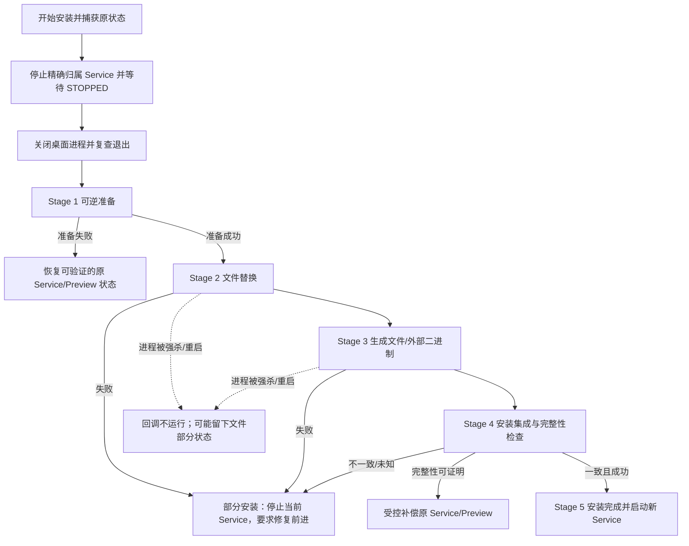

# #380 U1 Windows Service Upgrade Compatibility Gate

**状态：** `#380-U1 UPGRADE COMPATIBILITY READY_FOR_OWNER_REVIEW`
**用途：** 为 Owner 判断是否批准 U2 生产实施提供兼容性证据。此报告不证明 #380 Rebuild 缺陷已修复。

## 结论摘要

最终 Hosted Windows run `38178838324` 的两个同代配对与两个 side-by-side 混合配对均完成，旧客户端在 Service 缺失时实际 Direct 写入隔离索引。旧版 NSIS 全新安装成功，但 D1-A 原位升级返回 exit code 2；三次现场采样都看到旧 EXE hash、原 Service PID 和桌面 PID 保持不变，说明测试没有越过文件替换阶段。安装中断和 repair-forward 因此没有执行，仍为 `UNVERIFIED`。

兼容性结论不是通过：旧客户端在 Service 不可用时可自行索引；当前 side-by-side 混用只能证明因映像路径不同而拒绝，不能证明同一安装路径上的跨代安全。正常 NSIS 源码有 Stop/Wait 和桌面退出流程，但本次真实升级在任何可观察状态转换前退出。需要持久化 OS 安装闸门、版本身份协商和 DB 旧版本写入围栏后，才能考虑 U2。

旧版与 D1-A 使用相同的产品版本号、IPC v3 pipe 和安装身份；IPC 没有客户端/服务构建代际字段。D1-A 的 Admission 和严格事件处理改善了新版本间的失败关闭行为，但旧客户端不识别 Admission。当前 `Coordinator::rebuild()` 也仍在 Service Admission 之前写 `REBUILD_REQUIRED` 并标记全卷 stale。

## 基线与证据来源

| 候选 | 固定源码 / Tree | Version / Identifier | QA client-service EXE SHA-256 | Probe EXE SHA-256 | production EXE SHA-256 | NSIS SHA-256 |
|---|---|---|---|---|---|---|
| 旧版 master | `3275ac7c72df8ae4139a30f16c7f649971324e97` / `009576241cd4e8e2ba12cc644a368314f599faa6` | Cargo/package/Tauri/File/Product `0.1.40`; `com.startlan.zencanvas` | `597c1893d880cf5e78f079168d86fd868259492ce05f5a4c46402cd9a7f3dfe7` | `01dd6ae6d26ba70032f68abda5c6761d17998caa08a1dfb4d366623ab8cd4689` | `a89cee922b9dfbf6880bf6000dea95fedcd444032e42195ef9e0a75827b02432` | `b1fbd364ea8d6922ec7ade7b6c49b649f67674309780b746e7cc31430e0cd5b4` |
| D1-A | `d260131f9d6ec354f2361e6c7460c79e62e38391` / `4765285668095fb3d7c0dcefd8a8ba5f2bd4fb69` | Cargo/package/Tauri/File/Product `0.1.40`; `com.startlan.zencanvas` | `3be4535856fbac36a76ab5829743696b38799796a6ea91762c817cc69aaab6fc` | `d7991016fcf63d7c6a1a76e7f3311d998c8c79375c3099c1e96b338d0539ab7c` | `64c38ae49e641f21194228d39939a010bb6f21a1148e8bb9768fda688d5c3e35` | `67a17e369ef66cbcacdd8cab4d59cfec684062d398539c3e4d56a46be435dbb9` |

最终 run 解出的 NSIS payload EXE SHA 为旧版 `891cad540b849c2214dcbd0ed7980f4e1a6fbc6c7c154afd475cedbebd118d47`、D1-A `5d1f049ca77a68de9c7397642c5b1bbb7f11f66ec157541d64a271cf0031ce60`。包内 payload 与 Cargo release EXE hash 不同；旧版全新安装验证安装文件与旧 NSIS payload hash 相同。

| Harness revision | HEAD / Tree | Hosted Windows evidence |
|---|---|---|
| U1 final tested Harness | `371689c905ff5d26eb79062bbdd6441324ad8f53` / `da661271168c5310b6ee58f043356826306bcf8d` | Windows Server 2025 Datacenter 10.0.26100 x64, PowerShell 7.6.6; run `38178838324` — **FAIL**, D1-A in-place NSIS upgrade returned 2 |

两个冻结候选各自从指定 commit 建立 detached worktree。Harness 在编译前检查 commit、Tree 和源工作树，并分别生成 QA 二进制与正常 Tauri/NSIS 生产包。Windows 构建过程中 Tauri 模板会生成修改 `src-tauri/Cargo.toml`；Harness 会记录并还原这项构建副作用，然后确认冻结源仍与原 Tree 一致。混合配对使用任务专用 VHD/volume、配置目录和 console Service；NSIS 安装转换在确认 Hosted runner 的 canonical per-machine `C:\Program Files\Zen Canvas` 目录及 Service 注册不存在后使用默认路径。Hosted runner 作业结束后销毁，不访问真实用户索引数据。

这些是从指定源码构建的正常 release-mode desktop executable 和 NSIS package；不是已发布、正式签名并经真实自动更新分发的安装包。签名验证、更新器下载/替换路径及发行渠道回滚没有在 U1 覆盖。

**Hosted Windows 证据：** 最终 run job `114586872352`，链接 [run 38178838324](https://github.com/ArdenZC/Zen-Canvas/actions/runs/38178838324)。artifact ID `11717268713`，大小 173,029 bytes，归档 SHA-256 `daca764e93304e203c892df8f36f40e414bcc98c5cb71dee30d3b3b8e4c6e752`；[GitHub artifact](https://github.com/ArdenZC/Zen-Canvas/actions/runs/38178838324/artifacts/11717268713)。归档和独立 JSON/qualification 文件保存在 `docs/research/evidence/issue-380-u1/`；归档 ZIP 是逐字节原件，便于审阅的独立 JSON 副本统一为 LF 行尾。早期 runs 是 Harness 校准过程，不用于本报告最终兼容性结论。

### 证据分类

- **实测：** Hosted Windows 运行产物里实际的二进制 SHA、Service/桌面进程快照、fixture 数据库状态、installer exit code 和日志。
- **源码证明：** 当前冻结 commit 中可直接定位的协议、客户端、Service、Coordinator、Schema 与 NSIS 行为。
- **推断：** 根据源码路径推演，但没有完成对应 Windows 组合/崩溃测试。
- **UNVERIFIED：** 本环境或当前允许范围未验证；不能当成通过。

## 版本和 IPC 身份

**源码证明：** 两个候选的 Cargo/package/Tauri `version` 均为 `0.1.40`，产品 identifier 为 `com.startlan.zencanvas`。旧版与 D1-A 都使用 protocol version `3` 和 `\\.\pipe\ZenCanvas.GlobalIndex.v3`；request/response 有 protocol 和 request ID，事件帧有 request ID，但没有客户端 build ID、Service build ID、能力集、安装 generation 或 event sequence 字段。Windows Service 的来源认证比较 named-pipe client image path 与自身 `current_exe` path，并检查交互 session；它不比较进程映像 hash 或构建代际。

相关源码定位：旧版 `src-tauri/src/global_index/windows/service.rs` 的 protocol 常量/帧结构及 `validate_pipe_client`；D1-A 同文件的 `validate_response`、`call_stream_with_client`；D1-A `src-tauri/src/global_index/windows/service_host.rs::handle_index_request` / `try_begin_index_request`；旧版 `src-tauri/src/global_index/windows/mod.rs::run_with_fallback`；旧版 `src-tauri/src/global_index/coordinator.rs::Coordinator::rebuild`；`src-tauri/src/main.rs::main`；`src-tauri/windows/installer-lifecycle-synchronous.nsh`、`installer-lifecycle-final.nsh` 和 `installer-hooks.nsh`。

D1-A 实现仍是 IPC v3，不改 Schema、产品版本或安装器。相同路径下，旧进程已映射旧 EXE，而 Service 路径已替换为新 EXE 时，path equality 本身不能证明双方代际相同。这是由代码可推断的身份缺口；本轮精确同路径混合进程组合应按 Harness 实测/UNVERIFIED 状态报告，不能以路径检查视为 build 身份检查。

**同路径混用的源码推断（未做 runtime 证明）：** D1-A Service 在 provider 前发送 `Sources` Admission；旧客户端 `apply_event` 对 `Sources` 的分支只是 `Ok(())`，不会把它当 Admission 或拒绝后续帧。因而如果旧桌面进程仍在内存、其 image path 与新 Service 的 `current_exe` 路径同为安装路径，Service 的 path-only 校验可能接受它，旧 client 可能继续把后续 Provider/Entries/SourceState event 写到 Sink。相反，新 D1-A client 面对旧 Service 不发 Admission 的 v3 stream 会在有状态 Sink 前失败关闭；但 Coordinator 的 Rebuild 前置状态写入仍可先于 Service Admission。两种同路径代际交叉均未由 U1 直接运行验证。

## 兼容性矩阵

矩阵区分同代 SCM qualification、side-by-side 混合配对和同安装路径跨代运行。冻结候选是从指定源码构建的真实 EXE/NSIS 包，不是已签名发行包。同代 qualification 使用 SCM Service；混合配对使用候选 EXE 的真实 `--index-service` console host，执行相同的 IPC/Service Host 代码，但不是 LocalSystem token。fixture 使用独立 VHD/volume、profile 和 SQLite，不含 Managed/AI 关联。Reset helper 在每个目标请求前把 source metadata 置为 `discovered` 并清空 checkpoint/timestamps，但保留 active rows 与 FTS；拒绝测试因此只证明这些字段相对于 reset 后基线未变，不能证明旧非空 checkpoint 被保留。

| 桌面客户端 | Service | U1 运行方式 | 结果 / 数据影响 |
|---|---|---|---|
| old client | old Service | 候选 QA EXE + SCM qualification | **PASS**；旧客户端与旧 Service 同代请求完成。client/service SHA `597c1893…dfe7` |
| D1-A client | D1-A Service | 候选 QA EXE + SCM qualification | **PASS**；D1-A 同代 qualification 完成。client/service SHA `3be45358…b6fc` |
| new client | old Service | 同机 side-by-side，不同 EXE 路径，真实 D1-A recovery QA client | **PASS — fail closed**；旧 Service 响应 request ID 不匹配；客户端 exit 1；marker/FTS 无新行、active rows 和 entry_count 均为 4，source 保持 reset 后 `discovered`，无 error。无 Direct fallback。 |
| old client | new Service | 同机 side-by-side，不同 EXE 路径，真实旧版 client 与 D1-A console Service | **PASS — path rejection**；Service pipe 可达，D1-A 拒绝不同 executable path；旧客户端收到结构化 Service 拒绝，没有 Direct fallback；marker/FTS 无新行、active rows/entry_count 均为 4。 |
| old client | 无 Service | 真实旧版 QA client + 隔离 fixture | **FAIL — legacy Direct 已实测**；active rows / `entry_count` `4→5`，新 marker FTS 命中，旧 marker 保持 active，stale rows 0，source 最终 `ready`，`last_error=null`，journal cursor 与索引时间推进。 |
| new client | 无 Service | 未在 U1 作为独立场景运行 | **UNVERIFIED**；D1-A `NotSent` 仍可 Direct fallback；安装闸门必须覆盖 Service 暂不可达窗口。 |
| old/new client | 对方 generation Service，精确 canonical 同路径 | 同安装目录旧进程映像与新包/回滚 | **UNVERIFIED**；映像路径相同不能证明进程代际相同。NSIS 原位更新本次在文件替换前返回 2。 |

### 旧客户端 Direct fallback 的边界

**源码证明：** 旧版 `run_with_fallback` 对 Service transport `Err` 调用 `service_failed()`，然后运行 Direct provider。Service request 若收到有效错误响应则不会按 transport failure 进入此分支。D1-A 将 fallback 缩窄到 `NotSent`；明确请求级错误、MissingAdmission 和 UnknownOutcome 不会 Direct fallback，但 `NotSent` 仍可回退。U2 处理旧客户端风险不能只靠新 Service 返回 busy 或 IPC v3 Admission，因为旧客户端可能把连接失败映射为 Direct fallback。

更具体地说，旧版 `src-tauri/src/global_index/windows/mod.rs::run_with_fallback` 遇到 transport error 时先写 `UNAVAILABLE`，随后 Direct provider 仍可写本地数据库；Direct 成功后 Coordinator 可把源恢复为 `READY`。因此最终 `source.status` 单独不足以判断有没有发生 fallback，必须同时核对新 marker、活动 entries、FTS 查询和 entry count。D1-A 的 `NotSent` 分支也先写 `UNAVAILABLE` 再调用 Direct；`MissingAdmission` / `UnknownOutcome` 返回不同错误，不会调用 Direct。

**最终 run 实测：** old/no-Service 在 reset 后 `discovered` source 上启动了 Direct indexing。active rows 和 `entry_count` 从 4 到 5；新/旧 marker 都命中 FTS 且保持 active；`staleEntries=0`；source 变为 `ready`，`last_error=null`；journal ID 保持相同但 cursor 从 `712` 到 `1288`，full/incremental timestamps 前进。isolated database SHA-256 `5142cd1fcb719f8352d30ba815afe8297882481793b92f2902fcfbacbc6051e5`。这证明 Service 不可用并不阻止旧客户端扫描并提交本地索引。

两个 mixed-path 拒绝测试只证明 source/event/entry/FTS/count 不因请求而变化；测试前 checkpoint 和 timestamps 被 fixture reset 清空。Managed/AI 表不在 fixture 内，因此这些表及有效非空 checkpoint 的保存仍未验证。read-only reset/snapshot 结果和原始 Service logs 随 [artifact 11717268713](https://github.com/ArdenZC/Zen-Canvas/actions/runs/38178838324/artifacts/11717268713) 归档。

### 源码调用顺序对比

**旧版（IPC transport 失败）：** `Coordinator::rebuild()` 先刷新 provider、写源状态 `REBUILD_REQUIRED` 并对整卷 `global_entries` 标 stale，再启动后台协调器；provider 调用 Service，transport error 被旧 client catch-all 处理为 `UNAVAILABLE`，然后运行 Direct provider；Direct Sink 事件继续写 entries/stale/checkpoint/source 状态。该顺序证明旧版 Service 不可达时 Direct fallback 会发生在 Coordinator 已持久化 Rebuild 副作用之后。

**D1-A（请求发出后、没有收到 Admission）：** desktop Coordinator 的既有 Rebuild 前置行为不在 D1-A 改动范围，仍先触碰本地状态。新 client 验证 protocol/request ID 和 event request ID；Service 端 busy CAS、operation lock、fresh source identity/enabled 验证、发送 `Sources` Admission，再设置 service indexing 并调用 Provider。客户端只在收到与 request/source identity 匹配的 Admission 后才允许向 sink 交付状态/entry 事件；乱序/身份不匹配/未知执行结果 fail closed，不 Direct fallback。若请求未发送 (`NotSent`)，D1-A 仍可能 Direct fallback。

**重要限制：** 这只建立 Service 端 provider 前的可信 IPC Admission 边界，不建立本地 Rebuild intent 的持久化 CAS；Coordinator 的 `REBUILD_REQUIRED`/stale 仍可能发生在 Service Admission 前。U1 不构成 D1-B/C 的安全验证。

### 代码证据速查

| 事实 | 精确位置 |
|---|---|
| 版本号/identifier | `package.json`、`src-tauri/Cargo.toml`、`src-tauri/tauri.conf.json`（旧版与 D1-A 两个 Tree） |
| IPC v3 / pipe 名 | `src-tauri/src/global_index/windows/service.rs` 常量 `IPC_PROTOCOL_VERSION` / `INDEX_SERVICE_PIPE` |
| D1-A response/event/admission/source 校验 | D1-A `src-tauri/src/global_index/windows/service.rs::validate_response`、`call_stream_with_client`、`source_identity_matches` |
| Service session + exact image path 校验、不验 hash/build | `src-tauri/src/global_index/windows/service.rs::validate_pipe_client`（两代） |
| D1-A busy/source/admission/provider 顺序 | D1-A `src-tauri/src/global_index/windows/service_host.rs::handle_index_request` |
| old catch-all Direct fallback；先写 UNAVAILABLE | old `src-tauri/src/global_index/windows/mod.rs::run_with_fallback` |
| D1-A `NotSent` 可 Direct；MissingAdmission/UnknownOutcome 不 Direct | D1-A `src-tauri/src/global_index/windows/mod.rs::run_with_fallback` |
| Rebuild 前置 REBUILD_REQUIRED + 全卷 stale | `src-tauri/src/global_index/coordinator.rs::Coordinator::rebuild`（D1-A 未修改 Coordinator） |
| Service dispatch 早于 Tauri/DB startup | `src-tauri/src/main.rs::main`，`--index-service` 分支在 Tauri setup/open_database 前 |
| Schema 37 / future schema 拒绝 | `src-tauri/src/db/schema.rs::CURRENT_SCHEMA_VERSION` / `migrate`; `src-tauri/src/db/tests/part1.rs::database_rejects_schema_37_as_a_future_version` |
| Stop/wait/app exit 前置条件 | `src-tauri/windows/installer-lifecycle-final.nsh::ZCPrepareInstallLifecycleFinal`; helpers in `installer-lifecycle-synchronous.nsh` |
| Failure stages and partial repair path | `src-tauri/windows/installer-lifecycle-synchronous.nsh` stage defines; `installer-lifecycle-final.nsh::ZCHandlePostInstallFailureFinal` |
| Service auto start and crash restart | `src-tauri/windows/installer-hooks.nsh::InstallZenCanvasIndexService` |

## 安装、重启、中断及修复状态机

### 正常安装/升级顺序（源码证明）

1. 捕获当前 installer lifecycle / Service 状态。
2. `ZCInitializeInstallLifecycle` 先校验 Tauri 卸载注册信息、Preview 元数据及精确 Service ImagePath；失败会在任何 service 状态变更前终止。
3. 复核 Service ImagePath 归属；停止被捕获的 `ZenCanvasGlobalIndex` 并等待 SCM 报告 STOPPED。
4. 按进程名关闭桌面应用，等待 500ms 后再次查找。
5. 撤销 Preview 集成；generated NSIS template 在 EXE/resource mutation 前递增进程内 stage。
6. 安装新文件与资源；post-generated 阶段验证安装一致性，创建/复用 Service 并等待稳定 RUNNING。
7. Stage 5 才标记安装完成。

文件身份和生命周期调用由 `scripts/buildWindowsPackage.mjs`、`prepareWindowsNsisTemplate.mjs`、`finalizeWindowsNsisLifecycleOrchestration.mjs` 组合 `src-tauri/windows/tauri-2.11.2-installer.upstream.nsi`。Installer stage 是 NSIS 进程内变量，不是重启可恢复 marker。

### 失败与恢复规则（源码证明）

| 阶段 | 含义 | 当前 installer 恢复行为 |
|---|---|---|
| 0 | 未激活 | 不拥有恢复动作 |
| 1 | reversible preparation | 在 Service 停止/桌面退出/Preview 撤销失败时尝试恢复捕获的 Service/Preview 状态 |
| 2 | canonical file mutation | 旧产品一致性已未知；不恢复旧文件/Service，撤销当前 Preview 并停止当前精确 Service；保留 repair metadata |
| 3 | generated resource/external binary mutation | 即使主 EXE 看似完整也按部分文件处理；不恢复旧文件/Service，停止当前精确 Service |
| 4 | post-generated integration | 仅产品完整性检查证明一致时允许受控补偿；否则使用 partial failure 路径 |
| 5 | complete | 安装成功 |

U 路径是持久安装代际 marker 和启动闸门缺失的关键边界。最终 U1 run 的 D1-A installer 在文件 hash 改变前就以 2 退出，因此没有进入强制中断/修复场景。

Stage 2/3 的文件替换中断可留下部分文件；NSIS `.onInstFailed` 只处理进程内可观察错误，不能保证断电、强制终止、OS 重启等情形执行回调。服务安装时配置 LocalSystem、自动启动及 5/30 秒崩溃重启策略。源码中没有持久化 `upgrade-in-progress`、安装 generation 记录或在 Service/桌面 DB 初始化前执行的启动闸门。因此安装中断后旧 Service 或人工启动的旧客户端可能面对部分新文件/数据；具体重启时行为没有在本轮证明。

### Hosted Windows installer 证据

| 场景 | 观测范围 | 结果 |
|---|---|---|
| fresh old 安装 | 真正旧版 NSIS 包、默认 per-machine path、SCM Service | **PASS**；exit 0；安装目录 `C:\Program Files\Zen Canvas`；installed EXE SHA 与旧包 payload `891cad54…18d47` 一致；Service RUNNING，PID 6804，ImagePath 指向 canonical EXE |
| old → D1-A 原位升级 | D1-A NSIS SHA `67a17e36…35dbb9`；每 250ms 采样 installer、Service、桌面进程和目标 EXE hash | **FAIL / 未完成升级**；exit code 2，`samples=3`，目标 EXE hash 三次均为旧版 `891cad54…18d47`；Service PID 6804 一直 RUNNING；桌面 `--background` PID 7504 一直存活；没有观察到 STOPPED、桌面退出、新 EXE 或新 Service PID |
| 安装失败后原产品状态 | 完成最后一次采样 | 旧 Service、旧桌面和旧 EXE 仍在；注册信息仍是旧版，`EstimatedSize=35149`；因此本次失败没有观察到部分文件替换或旧代数据被新代写入 |
| 失败原因 | `/LOG` 路径、stdout/stderr、进程快照 | NSIS log 文件未生成，stdout/stderr 为空；具体哪个 pre-file validation 触发 exit 2 **UNVERIFIED**。当前实现会在 `ZCInitializeInstallLifecycle` 校验产品 metadata/Preview/Service 后才 Stop Service；`EstimatedSize` 是精确比较字段，注册值和 candidate 期望值是否不一致是待验证假设，不能记为 root cause |
| D1-A 文件替换后强制结束 installer | 监测到目标包 EXE hash 后杀 installer | `UNVERIFIED`；未出现新 EXE，因此没触发 |
| 中断后 D1-A repair-forward | 在真实部分替换状态下运行 D1-A 包 | `UNVERIFIED`；未执行 |
| OS reboot / crash dump | 当前 Hosted Harness 不重启 runner、不作电源故障注入 | `UNVERIFIED` |
| NSIS `.onInstFailed` 真正失败 callback 注入 | Harness 可观察中断/repair，不注入每个内部失败 label | `UNVERIFIED` |

安装测试使用 Windows Server 2025 Hosted runner，而不是用户机器。使用冻结源码重建的真实 NSIS 包；非正式签名发行包。本次现场只证明“D1-A 安装在文件替换前退出、旧一代仍然运行”，不证明正常 Stop/Wait 最终成功，也不证明 `.onInstFailed`、强制终止、OS reboot、回滚或 repair-forward。

## U2 最小安全实施建议

### 兼容性机制比较

| 机制 | 可阻止的情形 | 单独使用的缺口 |
|---|---|---|
| v3 capability/build handshake 字段 | 只有新客户端与新 Service 才能比较 build/capability | 旧 serde decoder 忽略未知 JSON 字段；旧客户端不会发送/核验能力，也会在 Service 不可达时 Direct fallback；不能限制旧客户端写 DB |
| IPC v4 独立 pipe 与严格 handshake | 新客户端拒绝旧 Service、旧协议、错误 generation/source/request；在 admission 前阻止 Service Provider | 已运行的旧客户端仍可使用 v3 pipe 或在 Service 停机时 Direct fallback；不能单独阻止其打开本地 DB |
| Installer Stop-the-world | 正常升级时先停 Service、等 STOPPED、退出 desktop，再替换文件并启动新 Service | 不覆盖 installer 强杀/断电/reboot、自动重启配置、升级期间重新启动的旧客户端、portable/复制的旧 EXE；没有持久升级门闩时无法保证恢复状态 |
| Desktop/Service 启动闸门 | 新代际在 DB/Coordinator/Service dispatch 前检查 upgrade marker、schema/generation | 仅进程内检查可被旧二进制绕过；marker 必须有 OS/ACL 强制边界，并由受控修复流程清除 |
| Schema v38 future-version fence | v38 提交后，旧版 v37 Database::open 拒绝访问，阻止旧客户端继续写迁移后的 DB | 迁移前的 v37 DB 仍可被旧进程写；迁移/回滚期间需要 OS gate 和一致性备份；不能代替 Service/installer generation 协议 |

**最小安全组合建议：** 独立 IPC v4 generation/capability handshake + 持久化升级门闩和 OS 强制启动/DB 写入闸门 + installer 禁用 Service 自动启动/失败重启并 Stop/Wait + v37→v38 future-schema fence 和在线备份 + 新客户端对所有 mutating Service 不确定结果关闭自动 Direct fallback。v3 增加字段、单独 IPC v4、或只依赖 NSIS 正常 stop 流程，均不能覆盖已实测的旧客户端 Direct fallback。

### IPC v4 最小字段合同（建议字段名）

以下是供 U2 设计评审的字段合同，不是已实现协议，也不代表协议版本已获 Owner 批准。`build_id` 应标识不可变的正式构建/包清单；`install_generation` 应在同一安装目录执行升级或修复时变化，不能只复用 `0.1.40` 这样的产品版本号。

| 消息 | 必须绑定的字段 | 目的 |
|---|---|---|
| Client Hello | `protocol_version`, `client_build_id`, `install_generation`, `supported_schema_min`, `supported_schema_max`, `capabilities` | Service 在处理任何 mutating request 前拒绝不兼容协议、构建代际、数据库范围或能力 |
| Service Hello / Admission | `protocol_version`, `service_build_id`, `install_generation`, `request_id`, `source_id`, `source_identity_digest`, `expected_operation_revision`, `admission` | 让客户端确认响应来自匹配 Service，并且此请求/源身份/修订已通过 busy claim 与 source validation；busy 是明确的拒绝值 |
| Mutating Request | `request_id`, `operation_id`, `install_generation`, `source_id`, `source_identity_digest`, `expected_operation_revision`, `command` | 把单一操作、源和 CAS revision 绑定，避免重复/旧请求被当作新操作接受 |
| Event | `protocol_version`, `request_id`, `operation_id`, `source_id`, `source_identity_digest`, `operation_revision`, `sequence`, `event` | Sink 前验证严格递增的每操作序号、身份、revision 和允许的事件状态机 |
| Final Response | `protocol_version`, `request_id`, `operation_id`, `install_generation`, `source_id`, `operation_revision`, `outcome` | 成功只在完整命令事件合同满足后返回；拒绝可分类；无响应/断线仍由客户端视为 UnknownOutcome，不得重放或 Direct fallback |

该合同须配合 Service 对 named-pipe client 的构建身份验证和 OS/DB gate；单靠消息字段无法阻止旧二进制绕过新 Service、直接打开 SQLite 或在 Service 不可达时执行 Direct。

U1 还暴露一个 installer 前置失败需要 U2 单独复现：旧版新装成功；D1-A 原位包在 EXE 替换前 exit 2，旧 Service/desktop PID 和二进制均保持。`installer-hooks.nsh::DetectZenCanvasPreexistingProduct` 会把 Add/Remove Programs `EstimatedSize` 与本包的期望值精确比较，并在 `ZCInitializeInstallLifecycle` 调用 Stop Service 之前执行；现有旧注册值为 35149。它是优先排查点，但本次没有 NSIS log 或 D1-A expected value，不能定为已证实根因。U2 必须增加 old→new 包级回归，并在修正前保留“升级失败、旧代仍运行”的失败关闭断言。

升级和修复按一个互斥状态机运行：

1. Installer 获得 machine-wide maintenance lock；先持久写入 generation/upgrade marker，再禁用 SCM 自动启动与 failure actions，停止 Service 并等待 STOPPED，阻止 desktop 启动并等待现有进程退出。
2. 在 gate 内做 SQLite online backup（包含 committed WAL），然后执行 v37→v38 原子迁移。marker 保持有效期间，只有 installer/受信 Service identity 可打开 DB；旧 portable/旧安装 EXE 不得获得写权限。
3. 安装文件和 v4 Service 完整后，校验 package/build generation、DB schema、Service ImagePath 与 health check。启动闸门仍保持关闭；通过检查后才恢复 SCM 启动/恢复策略并清除 marker。
4. 任一文件替换、DB migration、Service registration、health check 或机器重启中断，都保留 marker、禁用旧 Service restart 且不允许旧 desktop/Service 自启。默认只允许 repair-forward 到同一目标 generation。
5. 若 Owner 批准回退，先停止/禁用新 Service，在同一 maintenance lock 下恢复完整 v37 DB online backup 与匹配旧包，再验证数据/FTS/Service identity，最后才清除 marker。不能只把 `user_version` 改回 37，也不能让旧包对 v38 DB 启动。

**安装失败后的旧/新版本隔离：** Stage 2 以后不应尝试“部分文件回滚 + 旧 Service 重启”。NSIS 应留下由 OS startup gate 执行的 repair-required 状态，Service FailureActions 和 automatic start 不得绕过它；installer 修复前向收敛到 D1-U2 package。对于无法被旧二进制识别的 marker，需用 ACL/维护锁或 DB 路径/权限隔离强制执行。若 Windows per-user 数据目录和 LocalSystem Service 无法落实这个边界，则 U2 应阻止上线，直到 Owner 决定只支持可强制隔离的安装模式或迁移数据到新 generation 路径。

### 建议组合

单独增加 v3 capability 字段不足以建立代际边界：当前 v3 Request/Response serde struct 没有 `deny_unknown_fields`，旧 decoder 默认忽略未知 JSON 字段；当前 wire 也没有 generation/capability 字段。单独 IPC v4 仍不能阻止旧客户端在 Service 不可达时 Direct fallback；单独 Stop-the-world 安装流程不能覆盖中断、重启、手工启动和旧 portable binary。建议 U2 采用 **独立 IPC v4 + 持久安装闸门/Service stop-the-world + Schema 38 future-version fence + 明确关闭 mutating Direct fallback**，并以 generation identity 贯穿安装、Service、Client 和 SQLite。

1. 新 Service 暴露独立 v4 pipe。v4 handshake 核验 protocol、client build ID、service build ID、能力集、request ID、source identity、operation ID/revision 和 event sequence。拒绝旧 v3 mutating request 必须在 provider 调用之前给出明确负响应。v4 client 对 `NotSent`、拒绝和 UnknownOutcome 的 mutating 请求均不自动 Direct；除非用户明确切换到显式 Direct 模式。
2. Installer 在文件变更前持久化 generation/upgrade marker，关闭/禁用 Service 自动重启与自动启动，停止并等待精确 Service，退出桌面进程，再进入文件替换。部分升级或 reboot 后，Service 和新客户端必须 fail closed，完成 repair/health check 前不得创建 index operation。
3. gate 必须早于 `main.rs` 中 `--index-service` 分支和桌面端 `open_database`/Coordinator 初始化。非新 generation 启动、协议/能力不匹配、升级 marker 未清除时，拒绝所有 mutating request；installer repair-forward 成功并做完整性校验后才能恢复 Service 自动启动、清除 marker。
4. 对于本地有权限复制旧版 EXE 的用户态进程，进程内 startup gate 可被绕过。用 Schema v38 future-version fence 阻止旧数据库客户端迁移/写入，并在 v37→v38 迁移期间使用 OS ACL/目录访问闸门或等价的系统级维护锁，避免旧进程直接写用户 DB。ACL/gate 必须适配每用户安装和非管理员数据路径；若产品不能控制 portable copies 的 DB access，则需要 Owner 接受的明确支持边界/拒绝策略。
5. 先做一致性备份（SQLite online backup 覆盖已提交 WAL），在升级 gate 下 v37→v38 原子迁移。Schema 38 不重写、清 stale 或复制 active entries；保留现有搜索数据并添加可恢复操作意图/修订及 staging。任一迁移/repair 错误保持 gate，默认修复前进。不得仅把 `user_version` 降回 37；全量回退须同时恢复迁移前 DB/ WAL/Service/desktop package 和数据代际，并由 Owner 明确批准。

### 精确生产改动边界（建议，不在 U1 实施）

| 位置 | U2 建议变更 |
|---|---|
| `src-tauri/build.rs`、`src-tauri/tauri.conf.json` | 编译时注入不可复用的 build/release generation 身份；不能只使用相同的 `0.1.40` 产品版本 |
| `src-tauri/src/main.rs` | 在 `--index-service` dispatch、Tauri DB open 和 Coordinator 初始化前执行安装代际/schema/maintenance gate |
| `src-tauri/src/global_index/windows/service.rs` | 独立 IPC v4 pipe、Hello/capabilities/build IDs、严格 request/source/operation/revision/event sequence；拒绝旧协议 mutation |
| `src-tauri/src/global_index/windows/service_host.rs` | 身份/能力验证、busy claim/source validation 及持久化 Admission 顺序；在 provider 前 fail closed |
| `src-tauri/src/global_index/windows/mod.rs` | v4 身份和事件次序校验；mutating request transport failure/UnknownOutcome 不自动 Direct；仅显式 Direct 模式允许绕过 Service |
| `src-tauri/src/global_index/coordinator.rs` | A+B+C：先 CAS 建立持久化 operation intent；在可信 admission 前不得写 REBUILD_REQUIRED/stale；用 operation revision fence 所有状态更新 |
| `src-tauri/src/global_index/repository.rs` | Operation/staging 写入、可恢复 checkpoint；原子 publish 同时更新 active entries、Managed/AI 关联、FTS/count、source state/health/journal checkpoint |
| `src-tauri/src/db/schema.rs` | v38 additive migration；`global_volumes.operation_revision INTEGER NOT NULL DEFAULT 0`、活动 operation/intent 表、staged entry 和 stage checkpoint 表；用唯一约束/部分唯一索引限制一个 source 一个 active operation |
| `src-tauri/windows/installer-lifecycle-synchronous.nsh`、`installer-lifecycle-final.nsh`、`installer-lifecycle-wrapper.nsh`、`installer-hooks.nsh`、`tauri-2.11.2-installer.upstream.nsi`、`scripts/prepareWindowsNsisTemplate.mjs`、`scripts/finalizeWindowsNsisLifecycleOrchestration.mjs`、`scripts/buildWindowsPackage.mjs` | 加 machine-wide generation marker；文件变更前先禁用 SCM auto-start/failure restart，Stop/Wait Service，退出 desktop；repair-forward 和 health check 成功后才清门闩；任何重启失败都留下 repair-required gate。修正并测试 pre-file `EstimatedSize`/产品注册校验 |
| Windows installer/integration tests | 精确 old/new 包同路径升级；每个阶段强杀和重启恢复；修复安装；旧 binary 尝试启动/迁移 v38；Service failure action；DB 数据面和 WAL/backup 验证 |

### Schema 38 语义与迁移约束

- `operation_revision` 每次申请、取消、恢复或发布都单调增加；任何数据库写入必须用 revision/operation ID 比较交换；`updated_at` 不作为所有权凭据。
- `global_index_operations` 保存 operation ID、request ID、source ID、generation、revision、命令、phase、admission/lease 结果、开始/更新时间、failure/unknown outcome。唯一约束阻止同一 source 并行 active op；不同 source 可并行。
- 按 D0 已审核的最小草案，`global_index_rebuild_stage` 保存完整生产 entry 字段并以 operation + stable entry identity 去重；`global_index_rebuild_stage_checkpoint` 保存 provider 增量恢复 cursor。Stage 数据不被活动查询读取。
- publish 只在确认相同 operation/revision 仍 owner 时，一个 SQLite transaction 同时切换该 source 的 active entry 集合和 Managed/AI 引用、FTS、`entry_count`、source status、provider/journal checkpoint/last-full timestamp；旧 owner 不能清理新 owner 的 stage 或发布。
- 迁移过程不得 stale 老 active entries，不得清空 Managed Entry/AI Job/Analysis 数据。`user_version` 高于客户端支持范围时现有 v37 DB layer 会拒绝打开；U2 需保留这个 fail-closed 约束，并添加 migration/backup rollback tests。
- 成本、锁等待、WAL 峰值和 10k publish latency 必须在目标 Hosted Windows 磁盘/SQLite settings 实测；D0 测试原型测得约 10k 发布 7.4 秒和约 4.96 MB rollback WAL 的数值只是成本信号，不是生产性能承诺。
- 如果完整 19-field stage 或一次原子 merge 超出 Owner 的锁/WAL/磁盘预算，D0 已指出替代方案是 generation tables + 每来源 `active_generation` pointer；这会扩大查询和迁移范围，并要求 Managed/AI/FTS 查询全部按活动代际过滤，必须另做 prototype/性能测量和 Owner 批准，不能在 U1 假定它已解决成本问题。

## 必需 U2 验收矩阵

1. 精确旧/新 exe + Service 的四种组合，既包括不同路径也包括正式安装同一路径；hash、build ID、pipe generation 与 protocol mismatch 必须拒绝并检查 source/entries/FTS/count/checkpoint/Managed/AI 未变化。
2. old client + no Service、旧客户端遇 v4 Service 拒绝、new client + old Service、busy、Admission 拒绝、Response 丢失、断 pipe、Service restart 和用户取消；所有 unknown 结果都不得自动 Direct/replay。
3. 同源并发 request、跨源并发、重复 Request ID/Operation ID、旧 revision 回放、禁用源、source 身份变化、Protocol/Request ID 不匹配、乱序/旧 event sequence、Service 构建身份不匹配。
4. 每个 installer Stage 在文件写前后杀进程/重启；Service failure action 不应在 marker 存在时拉起旧/半新 binary；repair-forward、失败 repair、完整 DB restore downgrade。
5. 填充 Managed Entries、AI Jobs/Items/Analysis、FTS、source health、count、checkpoint 的 v37 DB：成功迁移及每条失败注入/恢复后比对完整逻辑快照和 FTS 搜索结果。
6. 写事务注入 `SQLITE_BUSY/LOCKED`、I/O error、WAL/磁盘空间耗尽、提交失败、service 崩溃、进程崩溃；确保旧活动索引持续可读，操作意图可恢复，不能伪 READY/INDEXING。
7. 1k/10k Windows benchmark 事务锁定时间、peak WAL、checkpoint、rollback 时间、磁盘空间、低可用空间；设置明确上限和启动限流。在证明成本前不跑/承诺 100k/500k 自动 benchmark。

## 未解决问题与 Owner 决策

- 是否 IPC v4 和 Schema v38 同一 release 提供？建议按一个兼容性 gate 发布，而不是允许 v4 client 与旧 Service 无保护混用。
- 是否取消 mutating request 的自动 Direct fallback，包括 `NotSent`？旧客户端无法被新 Service 控制；建议由安装器/Schema 版本 fence 和 OS DB gate 一起保护。
- portable/手工复制旧二进制是否在支持范围？若在，如何强制隔离它访问升级后的用户数据库？
- 每用户 Windows 安装如何安全使用管理员 Service、ACL、用户数据目录维护 gate？Hosted runner 的本轮结果不覆盖真实 Windows 11 管理员/UAC 场景。
- 部分文件升级失败后，产品政策是否只允许 repair-forward？何种情况下允许恢复完整 v37 DB/旧包？谁批准不可逆的数据回退？
- v37→v38 最大可接受 DB 写阻塞、WAL 上限、低磁盘行为和大索引 publish 延迟是多少？
- 需要哪些 Hosted Windows reboot/failure injection、签名生产包和正式 release cohort 才足够批准 U2？

## 未验证风险和 U1 限制

- 精确同路径 old/new 混合 generation Service/client；路径校验不是 build 身份校验。
- Windows 11 end-user / UAC、每用户安装与管理员 LocalSystem service 的组合。
- 混合版本 console-host 配对没有以 LocalSystem SCM token 运行；其 named-pipe/client-image 和协议代码是真实候选实现，权限上下文仍未验证。
- OS reboot、断电和磁盘故障下 NSIS Stage 2/3 的真实开机状态。
- 每个 NSIS 内部 failure label / `.onInstFailed` callback 的故障注入。
- v37 populated DB 实际升级 v38、SQLite online backup restore、Schema 回退。U1 未改/运行正式 Schema。
- 有效非空 checkpoint 在混合拒绝后的保留；本 U1 fixture 请求前会把 checkpoint/timestamps reset 为 null。Direct fallback 的 cursor 前进已记录。
- 混合版本下 Managed/AI 表的全量快照；当前 U1 fixture 测试聚焦 Global Index marker/state/count/FTS。
- D1-A/U1 没有解决 `Coordinator::rebuild()` 的预 admission 状态写入或旧 active index 原子发布问题；仍需要 D1-B/C 与 Owner 批准的 Schema/IPC 架构决策。

## 最终 U1 状态

`#380-U1 UPGRADE COMPATIBILITY READY_FOR_OWNER_REVIEW`

这是报告和证据已完整、等待 Owner 决策的状态，不是 Windows upgrade gate 通过，也不是 #380 生产缺陷已修复。最终 exact-source Hosted Windows Gate `38178838324` 的资格配对和 mixed-path 数据检查完成，但 D1-A 原位 NSIS upgrade exit 2；中断、reboot 和 repair-forward 未验证。不得在未解决旧客户端 Direct 写入和 installer pre-file 失败前批准混合版本升级。
